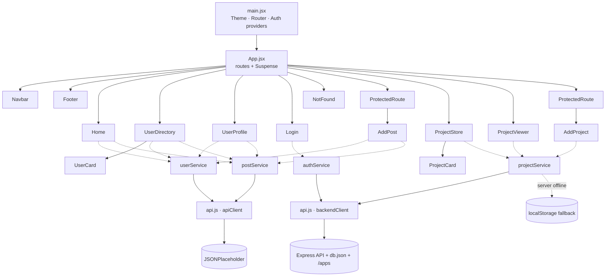

# DevDirectory — Engineering Portal & Project Store

BCA · Modern Frontend Frameworks · Lab Project

A responsive React SPA where engineering managers **search developers**, **read their publications**, **publish bulletins** under a protected session — and a built-in **Project Store** that works like a private app store: add small projects (news app, todo app, anything), then launch them inside the portal.

**Stack:** React 18 · React Router v6 · Axios · Modern CSS (design tokens, dark/light) · Node + Express backend (JWT, file uploads)

---

## Quick start

```bash
npm run setup        # installs frontend + backend dependencies
npm run dev:all      # web → http://localhost:5173   api → http://localhost:5000
```

Frontend only (no backend): `npm install && npm run dev` — the Store falls back to browser storage automatically.

Production check (spec deliverable): `npm run build && npm run preview`

**Demo login:** `aarav.sharma@devdirectory.in` / `devdir@123` (the "Use demo account" button fills it).

---

## Spec compliance map

| Requirement | Where |
| --- | --- |
| Folder structure (`assets, components, context, hooks, pages, services, App, main`) | `src/` — exactly as specified, plus `utils/` and `data/` |
| Routes `/ /users /users/:id /login /add-post *` | `src/App.jsx` |
| Single Axios client, base URL `jsonplaceholder.typicode.com`, 8 s timeout | `src/services/api.js` (default export) |
| `GET /users`, `GET /users/:id`, `GET /posts?userId=`, `POST /posts` | `userService.js`, `postService.js` |
| `AuthContext` → `isAuthenticated`, `login(userPayload)`, `logout()` | `src/context/AuthContext.jsx` |
| `ProtectedRoute` → `<Navigate to="/login" replace state={{ from: location }} />`; redirect back after login | `ProtectedRoute.jsx`, `Login.jsx` |
| Controlled form, select from `GET /users`, title 5–80, body 20–500, disabled button + inline errors, 201 → green success + reset | `src/pages/AddPost.jsx` |
| Debounced real-time search by name or company | `UserDirectory.jsx`, `hooks/useDebounce.js` |
| Skeleton while pending; dismissible error banner with **Retry**; layout never breaks | `SkeletonLoader.jsx`, `AlertBanner.jsx`, every page |
| 404 page with link home | `NotFound.jsx` |

> **Indian names:** JSONPlaceholder returns western placeholder names. The live API stays the source of truth (ids, usernames, website), and `userService.js` overlays an Indian engineering-team profile on each record. Searching the original API name (e.g. "Leanne") still works, so the acceptance scenario passes.

> **fetch rule:** all network calls inside `src/` go through Axios services. The two bundled demo apps in `public/projects/` are standalone static sites (separate from the React source).

## v2 upgrade — Employee & Project Tracking
See **UPGRADE_GUIDE.md** (task tracker, status badges, priority/deadlines, toasts, advanced filters, live dashboard, black-and-orange redesign).

## Extra features (beyond the spec)

**Project Store** — search · category filters · sort (newest / popular / A→Z) · likes · launch counter · full-screen **in-portal launcher** with desktop/tablet/mobile preview sizes · add / **edit** / delete projects · three ways to add: **upload a `.zip` build**, **upload a single `.html`**, or **link a live URL** · live card preview while filling the form · backend status pill.

**Directory** — city chips · sort by name/company/city/experience · save ★ favourites · `/` shortcut to focus search.
**Profile** — publications accordion · projects tab · one-click copy email.
**Publish** — live preview · character counters · autosaved draft · new posts appear on the author's profile.
**Platform** — dark/light theme · lazy-loaded routes · ErrorBoundary · skip-link & ARIA · reduced-motion support · animated stats · works offline-first (local fallback when the API server isn't running).

## Adding your own projects (news app, todo app…)

1. Sign in → **Project Store → ＋ Add project**.
2. Pick how it launches:
   - **Upload build** — `.zip` containing `index.html` (for Vite/CRA builds set `base: './'` / `"homepage": "."`), or just one `.html` file.
   - **Live URL** — Netlify / Vercel / GitHub Pages link. (Sites that send `X-Frame-Options` can't be embedded; the viewer has an *Open in new tab* button.)
3. Choose icon, colour, tags → **Publish to Store**.

Two sample projects ship in the Store already: **TaskFlow (todo)** and **India Pulse (news reader)**, in `public/projects/`.

## Backend API (`server/`)

| Method | Endpoint | Auth | Purpose |
| --- | --- | --- | --- |
| GET | `/api/health` | – | Status check |
| POST | `/api/auth/login` | – | Returns JWT (8 h) |
| GET | `/api/auth/me` | ✔ | Current user |
| GET | `/api/projects?q=&category=&sort=` | – | List / search |
| GET | `/api/projects/:id` | – | Single project |
| POST | `/api/projects` | ✔ | Create (multipart, optional `file`) |
| PUT | `/api/projects/:id` | ✔ | Update |
| DELETE | `/api/projects/:id` | ✔ | Delete (also removes hosted files) |
| POST | `/api/projects/:id/view` · `/like` | – | Counters |

Data lives in `server/data/db.json` (auto-created). Uploaded builds are unpacked to `server/storage/apps/<id>/` with zip-slip protection and size limits, then served at `/apps/<id>/…`. Copy `server/.env.example` to `server/.env` to change the port, JWT secret or allowed origins.

## Architecture & data flow (for the PDF report)



## Commit convention
`feat:` `fix:` `style:` `refactor:` `docs:` — repo name: `bca-frontend-devdirectory-<RollNumber>`.

## Security notes
Uploaded projects run in a sandboxed `<iframe>` and are served from the API origin, not the portal's. Only signed-in users can add/edit/delete. Change `JWT_SECRET` and replace the seeded demo users before any real deployment.
